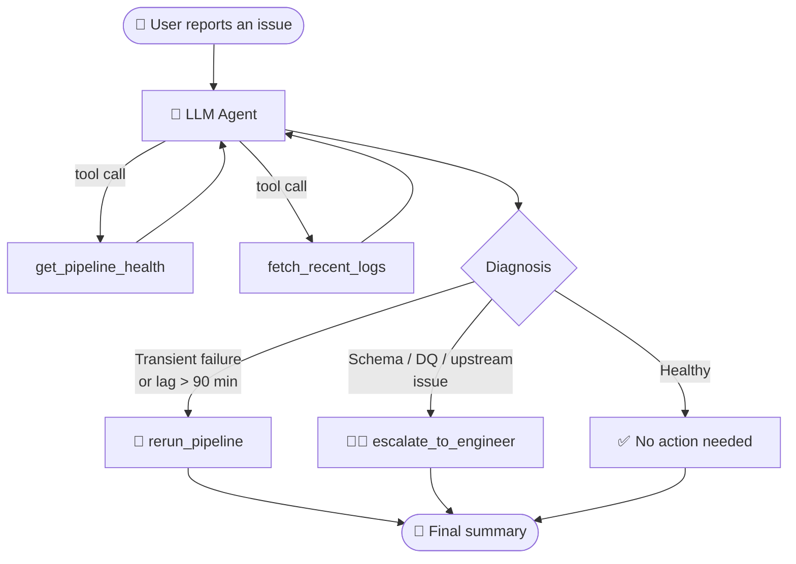

<div align="center">

# 🚨 Data Pipeline Incident Agent

**An LLM-powered "first responder" that investigates broken data pipelines, fixes what it can, and escalates what it can't.**


</div>

---

## 📖 Overview

When a dashboard goes stale or a table is missing data, someone usually has to:
check the job status → read the logs → decide whether to hit "rerun" or call an engineer.

This project hands that triage loop to an **autonomous AI agent**. You describe the problem in plain English, and the agent:

| Step | What it does |
|------|--------------|
| 🔍 **Investigate** | Checks pipeline health (last run status, data lag, failed records) and pulls recent job logs. |
| 🔁 **Act** | If the failure is **transient** (timeout, stuck task) or data lag is **> 90 minutes**, it **reruns** the pipeline. |
| 🧑‍💻 **Escalate** | If a rerun won't help (schema mismatch, data quality failure, upstream source down), it **opens a ticket** for a human data engineer. |
| ✅ **Report** | Replies with a short, human-readable summary of what it found and what it did. |

---

## 🧠 How It Works

The agent is a classic **tool-calling loop**: the LLM decides which tool to call, the Python runtime executes it, and the result is fed back until the model has enough information to give a final answer.



### 🧰 Agent Tools

| Tool | Purpose |
|------|---------|
| `get_pipeline_health(pipeline_id)` | Returns last run status, data lag (minutes), and failed record count. |
| `fetch_recent_logs(pipeline_id, lines)` | Returns the last *N* lines of job logs for diagnosis. |
| `rerun_pipeline(pipeline_id)` | Triggers a rerun of the pipeline job. |
| `escalate_to_engineer(summary)` | Creates an escalation ticket with an incident summary. |

> ℹ️ In this POC the tools return **mocked data**, so you can see the agent's reasoning on realistic scenarios without connecting to real infrastructure.

---

## 🧪 Test Scenarios

Five simulated pipelines cover the main decision paths:

| Pipeline | Symptom | Root Cause (from logs) | Agent Decision |
|----------|---------|------------------------|----------------|
| `sales-etl-daily` | Dashboard stale, 185 min lag | Task timed out, worker lost heartbeat | 🔁 **Rerun** |
| `customer-sync-02` | "Something seems off" | All checks passed, 5 min lag | ✅ **No action** |
| `orders-ingest-03` | Today's orders missing | `SchemaMismatchError`, 12,450 rows rejected | 🧑‍💻 **Escalate** |
| `clickstream-stream-09` | Analytics not updating | Kafka broker connection refused | 🧑‍💻 **Escalate** |
| `inventory-agg-04` | Routine check | Healthy, 10 min lag | ✅ **No action** |

### Example run

```text
--- New Incident: The sales dashboard hasn't refreshed since this morning. Can you check sales-etl-daily? ---

[AI Thinking...]
-> TOOL: Checking health for sales-etl-daily...
-> TOOL: Fetching last 20 log lines for sales-etl-daily...

[AI Thinking...]
-> TOOL: Rerunning pipeline job...

[FINAL RESPONSE]: `sales-etl-daily` failed because the `aggregate_sales` task timed out
after losing its worker heartbeat, and the dashboard data was 185 minutes behind.
I triggered a rerun successfully.
```

```text
--- New Incident: The orders table is missing today's data. Check orders-ingest-03. ---

[AI Thinking...]
-> TOOL: Checking health for orders-ingest-03...
-> TOOL: Fetching last 10 log lines for orders-ingest-03...
-> TOOL: Escalating to data engineer...

[FINAL RESPONSE]: orders-ingest-03 failed. The source has `order_total_usd` instead of the
expected `order_total` (DECIMAL), and 12,450 rows failed data-quality checks. The load was
aborted, so a rerun is unlikely to help until the schema issue is fixed. I escalated this
to a data engineer.
```

---

## 🚀 Getting Started

1. **Open the notebook** [`Data_Pipeline_Incident_Agent_POC.ipynb`](Data_Pipeline_Incident_Agent_POC.ipynb) in Google Colab.
2. **Add your API key** as a Colab secret named `OPENROUTER_APIKEY` (🔑 icon in the left sidebar).
3. **Install the dependency** (if needed):
   ```bash
   pip install openai
   ```
4. **Run all cells.** The final cells run each test scenario and print the agent's reasoning trace.

Try your own incident:

```python
run_it_agent("The finance report looks empty today. Can you check sales-etl-daily?")
```

> 💡 Running outside Colab? Replace `userdata.get('OPENROUTER_APIKEY')` with `os.environ["OPENROUTER_APIKEY"]`.

---

## 📂 Project Structure

```
Data_pipeline_incident_agent/
├── Data_Pipeline_Incident_Agent_POC.ipynb   # Agent, tools, and test scenarios
└── ReadMe.md                                # You are here
```

---

## 🛣️ Roadmap / Next Steps

- [ ] Connect tools to real orchestrators (Airflow, Dagster, Databricks Jobs)
- [ ] Create real tickets in Jira / PagerDuty / Slack
- [ ] Add retry limits and guardrails so the agent can't rerun in a loop
- [ ] Ask a human to approve risky actions before they run
- [ ] Keep incident history so the agent can spot recurring failures

---

<div align="center">

Built as an exploration of **agentic AI for DataOps** ⚙️

</div>
